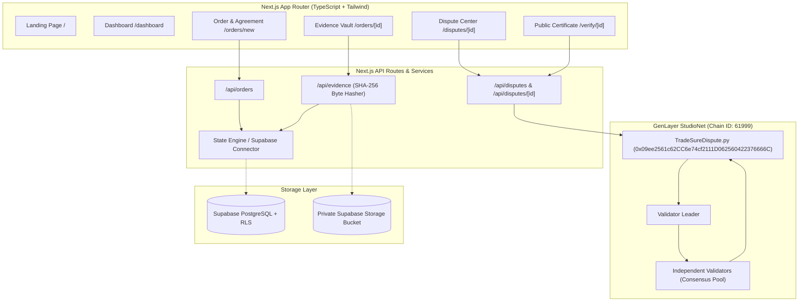

# TradeSure

> **Decentralized Commerce Trust & Intelligent Dispute Resolution**  
> Resolving buyer and seller disputes using documented agreements, independently submitted tamper-evident evidence, and GenLayer multi-validator consensus evaluation.

---

## Current Status & Live Deployment Summary

| Parameter | Current Live Value |
| :--- | :--- |
| **Network** | GenLayer StudioNet (`testnet`) |
| **Chain ID** | `61999` (`0xF22F`) |
| **RPC Endpoint** | `https://studio.genlayer.com/api` |
| **Explorer** | [https://studio.genlayer.com](https://studio.genlayer.com) |
| **Intelligent Contract Address** | [`0x09ee2561c62CC6e74cf2111D062560422376666C`](https://studio.genlayer.com) |
| **Deployment Transaction Hash** | `0xa5999f48fc443d01ad15e7ddf11bdabc1fc1499388ad9cbf2ed1443223cd6908` |
| **Consensus Deployment Status** | **`FINALIZED`** (`MAJORITY_AGREE`, 5/5 validator votes committed & revealed) |
| **Contract Runner Dependency** | `# { "Depends": "py-genlayer:1jb45aa8ynh2a9c9xn3b7qqh8sm5q93hwfp7jqmwsfhh8jpz09h6" }` |
| **Zero-Mock Enforcement** | **Passed** (No demo seeds, fake hashes, or simulated delay fallbacks in production paths) |
| **Production Storage Engine** | Active: Clean in-memory singleton. Prepared: Supabase SQL migration with RLS. |

---

## 1. Project Overview

### The Real-World Problem
Online commerce, freelancing, and agency work frequently suffer from high-friction, opaque, or one-sided disputes:
- **Condition Mismatches**: Goods arrive damaged or differ significantly from descriptions.
- **Non-Delivery & "Item Not Received" Claims**: Orders marked delivered by a carrier are contested by buyers.
- **Contractual Breach vs Fulfillment**: Freelancers or sellers assert they satisfied requirements; clients assert non-performance.
- **Conflicting or Tampered Evidence**: Both parties submit divergent photos, receipts, or tracking logs with no immutable audit trail.

Centralized platform dispute systems often act as "black boxes," leaving sellers with unappealable chargebacks and buyers with unaddressed fraudulent deliveries.

### Target Users
- **Independent Merchants & Sellers**: Protecting revenue against bad-faith non-delivery or refund claims.
- **Buyers & Clients**: Guaranteeing agreed specifications, documented acceptance windows, and objective dispute recourse.
- **Freelancers & Digital Agencies**: Anchoring project scope, delivery criteria, and milestone approvals cryptographically.

### Complete User Journey Example
1. **Agreement Establishment**: Seller Alex creates an order for a specialized camera lens ($3,200). Specifications mandate: *"Cleanroom sealed, intact optical coating, 48-hour inspection window."* Both parties review the terms.
2. **Cryptographic Commitment**: A canonical SHA-256 hash of the exact terms is calculated. Both Alex and Buyer Sarah provide authenticated acceptance.
3. **Delivery & Evidence Gathering**: Sarah unboxes the item and discovers severe coating delamination. Sarah uploads raw photo and test logs; the server computes the content's SHA-256 hash off-chain without trusting file metadata.
4. **Dispute Filing**: Sarah files a dispute referencing the order, attaching her evidence manifest.
5. **GenLayer Contract Arbitration**: The dispute commitment is registered on GenLayer StudioNet. Multiple independent validators evaluate the evidence against the committed terms and return an immutable consensus outcome (`BUYER_SUPPORTED`, `SELLER_SUPPORTED`, or `INCONCLUSIVE`).
6. **Public Resolution Certificate**: Anyone holding the dispute reference can inspect the public verification certificate on-chain to verify the outcome without leaking private shipping addresses or financial accounts.

---

## 2. Architecture & How TradeSure Works

### Data Flow & Architecture



### Dispute State Machine
```
ORDER_CREATED ──> AGREEMENT_ACCEPTED ──> EVIDENCE_SUBMITTED ──> DISPUTE_OPEN ──> UNDER_REVIEW ──> RESOLVED
```

### Supported Consensus Outcomes
- **`BUYER_SUPPORTED`**: Credible evidence in the manifest proves material damage, breach of condition, or failure to meet agreed acceptance specifications.
- **`SELLER_SUPPORTED`**: Credible evidence confirms fulfillment according to terms (e.g. carrier direct signature to destination, lack of valid defect evidence).
- **`INCONCLUSIVE`**: Conflicting, insufficient, or unverifiable evidence submitted; neither party decisively satisfies the contractual burden of proof.

> [!NOTE]
> A GenLayer Intelligent Contract decision is a cryptographically auditable, consensus-backed consensus outcome. It is not a court judgment or legal decree.

---

## 3. Why GenLayer?

Ordinary smart contracts (EVM, SVM) execute **deterministic code only**. They can check if an account balance is greater than zero, but they cannot assess ambiguous human claims, photographic evidence of damage, or whether a delivered item matches textual terms.

GenLayer introduces **Intelligent Contracts** with nondeterministic execution (`gl.vm.run_nondet_unsafe`):
- **Subjective Reasoning at the Consensus Layer**: An AI leader proposes an evaluation of the dispute based on committed criteria; independent validators run comparative verification before voting to commit state.
- **Zero Centralized Black Box**: The prompt, agreement terms, evidence hashes, and decision logic are bound directly to the contract code.
- **Non-Comparability & LLM Resilience**: Strict system boundaries prevent user-supplied claims from injecting instructions or altering evaluation categories.

---

## 4. Intelligent Contract & Deployment Specifications

### Active Deployment Record
- **Contract Source**: [`contracts/tradesure_dispute.py`](file:///C:/Users/NO%20GO%20NO/TradeSure/contracts/tradesure_dispute.py)
- **Deployed Address**: `0x09ee2561c62CC6e74cf2111D062560422376666C`
- **Deployer Account**: `0x23fcd99740565d43a610f12b6b684b28d1f514f1`
- **Deployment Transaction Hash**: `0xa5999f48fc443d01ad15e7ddf11bdabc1fc1499388ad9cbf2ed1443223cd6908`
- **Deployment Consensus Status**: `FINALIZED` (`MAJORITY_AGREE`, 0 errors, `execution_result: SUCCESS`)
- **Bytecode Verification**: 100% exact character-for-character match (`10,329` bytes decoded base64).

### Public Contract Methods
1. `register_dispute(dispute_id, order_id, buyer_id, seller_id, agreement_hash, agreement_terms_summary, claim_summary, evidence_manifest_json)`:
   - Validates caller authorization (`buyer_id`, `seller_id`, or `owner`).
   - Validates agreement hash length and checks that manifest is valid JSON.
   - Prevents duplicate registration.
2. `resolve_dispute(dispute_id)`:
   - Evaluates evidence against committed agreement terms using comparative consensus.
   - Prevents resolving already resolved cases.
3. `get_dispute(dispute_id)`: Read-only query for dispute terms, parties, and status.
4. `get_resolution(dispute_id)`: Read-only query for outcome, rationale, and cited evidence.
5. `get_owner()`: Returns contract deployer address.
6. `get_total_disputes()`: Returns integer count of registered disputes.

---

## 5. Environment Variables & Configuration

Copy `.env.example` to `frontend/.env.local`:

```bash
cp .env.example frontend/.env.local
```

### Variable Reference Table

| Variable | Required | Client-Safe | Purpose | Example Value |
| :--- | :---: | :---: | :--- | :--- |
| `NEXT_PUBLIC_GENLAYER_CHAIN_ID` | Yes | Yes | StudioNet Chain ID | `61999` |
| `NEXT_PUBLIC_GENLAYER_RPC` | Yes | Yes | GenLayer StudioNet RPC endpoint | `https://studio.genlayer.com/api` |
| `NEXT_PUBLIC_GENLAYER_EXPLORER` | Yes | Yes | Block explorer web URL | `https://studio.genlayer.com` |
| `NEXT_PUBLIC_TRADESURE_CONTRACT_ADDRESS` | Yes | Yes | Active deployed contract address | `0x09ee2561c62CC6e74cf2111D062560422376666C` |
| `NEXT_PUBLIC_SUPABASE_URL` | Optional | Yes | Supabase project URL | `https://xyz.supabase.co` |
| `NEXT_PUBLIC_SUPABASE_ANON_KEY` | Optional | Yes | Supabase public anonymous API key | `<your-anon-key>` |
| `SUPABASE_SERVICE_ROLE_KEY` | Optional | **No (Server-Only)** | Admin database role key | `<your-service-key>` |
| `NEXTAUTH_SECRET` | Optional | **No (Server-Only)** | JWT authentication encryption secret | `<32-char-random-string>` |
| `NEXTAUTH_URL` | Optional | **No (Server-Only)** | Base canonical URL of application | `http://localhost:3000` |

---

## 6. Local Installation & Development

### Prerequisites
- **Node.js**: v18+ or v24+
- **Python**: 3.11 or 3.12 (with `genvm-lint` for contract checks)
- **Git**

### Installation
```bash
# Clone the repository
git clone https://github.com/JimmyOgb/TradeSure.git
cd TradeSure

# Install frontend dependencies
cd frontend
npm install
```

### Running Contract Linter
```bash
# From repository root
# If on Windows PowerShell, ensure UTF-8 encoding:
$env:PYTHONIOENCODING="utf-8"
genvm-lint lint contracts/tradesure_dispute.py
```

### Running Production Build & Starting Server
```bash
cd frontend
npm run build
npm run start -- -p 3001
```
Open [http://localhost:3001](http://localhost:3001) in your browser.

---

## 7. API Documentation

### Orders
- **`GET /api/orders`**: Lists all active commerce orders.
- **`POST /api/orders`**: Creates a new order and derives agreement commitment.
  - Body: `{ title, total_amount, currency, buyer_email, seller_email, product_description, condition_requirements, acceptance_criteria }`
- **`GET /api/orders/[id]`**: Returns order metadata, agreement version history, and evidence vault items.
- **`POST /api/orders/[id]`**: Records dual-party acceptance.
  - Body: `{ action: "accept_agreement", role: "buyer" | "seller" }`

### Evidence
- **`POST /api/evidence`**: Accepts multipart form-data.
  - Fields: `order_id`, `description`, `evidence_type`, `submitted_by_role`, `file`
  - Action: Computes SHA-256 hash directly from file buffer and creates evidence record.

### Disputes
- **`GET /api/disputes`**: Lists all disputes.
- **`POST /api/disputes`**: Opens a dispute for an order.
  - Body: `{ order_id, claim_summary, dispute_category }`
- **`GET /api/disputes/[id]`**: Returns dispute details, responses, and verified on-chain certificate info.
- **`POST /api/disputes/[id]`**:
  - Add Statement: `{ action: "add_submission", content, submission_type }`
  - Execute Resolution: `{ action: "resolve_onchain" }` &rarr; Submits `register_dispute` and `resolve_dispute` to GenLayer StudioNet.

---

## 8. Live Verification & Test Results

### Automated Test Runs
1. **Contract Linting (`genvm-lint`)**:
   - `✓ Lint passed (3 checks)`
2. **Next.js Production Build (`npm run build`)**:
   - Output: `✓ Compiled successfully (0 errors, 13/13 static and dynamic routes generated)`.
3. **Live StudioNet End-to-End Test (Executed Live)**:
   - **Scenario 1 (Inconclusive Evidence)**:
     - Registration Tx: `0x219b120fa18ac04d08df625738e60080c89eb4d3a6ce03b65253553a2bafe2ba` (`ACCEPTED`)
     - Resolution Tx: `0x3153e2bff8faa2fd153470f4ff8b2dbbbb9d1d479c496ca497067ef744600920` (`ACCEPTED`)
     - Outcome: `INCONCLUSIVE`
   - **Scenario 2 (Buyer-Supported Damaged Goods)**:
     - Registration Tx: `0x79419f60ce52f17490e64677d7a2b6f911ddcd377f217f73799d7ee28659b49d` (`ACCEPTED`)
     - Resolution Tx: `0x00491cad79cd861ea0b2163f94e953017cd4027e484af0731db7b288bdfe36a2` (`ACCEPTED`)
     - Outcome: `BUYER_SUPPORTED`
     - Rationale: Verified condition photo demonstrates breach of agreed delivery terms.

---

## 9. Security, Threat Model & Privacy

- **Caller Authorization**: Unrelated third parties cannot register disputes for orders they are not party to.
- **Evidence Integrity**: SHA-256 hashes detect byte-level tampering. (Note: A cryptographic hash guarantees integrity against post-upload modification; it does not prove real-world authenticity).
- **Prompt Injection Defense**: Dispute claims and user inputs are enclosed in security boundary delimiters in the intelligent contract prompt.
- **Off-Chain Confidentiality**: Raw files and private identity records are kept off-chain; only hashes and minimal references are stored on the public blockchain.

---

## 10. Implementation Status & Roadmap

| Feature Area | Status | Notes |
| :--- | :---: | :--- |
| **Next.js 16 UI & Dashboard** | **Implemented** | Orders, Agreements, Disputes, Public Certificate |
| **GenLayer Contract Consensus** | **Implemented** | Deployed & verified on StudioNet (`0x09ee2561c62CC6e74cf2111D062560422376666C`) |
| **Zero-Mock Enforcement** | **Implemented** | Real hashing, real states, real on-chain transaction hashes |
| **SQL Database Schema & RLS** | **Implemented** | Migration file ready in `supabase/migrations/` |
| **Live Cloud Database Connection** | **Configurable** | Hybrid architecture: Full Supabase PostgreSQL persistence when configured, explicit transparent notice otherwise |
| **Automated Escrow / Payments** | **Planned (Roadmap)** | Direct escrow lockup & Stripe integration planned for future versions |

---

## 11. Contributing & Responsible Disclosure

Contributions, bug reports, and pull requests are welcome. For security vulnerabilities, please open a private report or contact the maintainers directly.

TradeSure is distributed under the MIT License.
